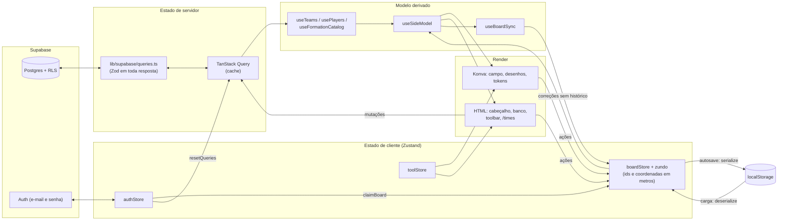

# Arquitetura — Prancheta Tática

Este documento explica por que a stack é esta e por que o código é escrito desta maneira. Ele é para quem vai mexer no projeto ou avaliar as decisões, e supõe familiaridade com React, TypeScript e as bibliotecas citadas.

O que ele não repete:

- O comportamento do produto está em [`especificacao.md`](especificacao.md), que é a fonte da verdade.
- O histórico de sessões, as decisões datadas e o plano até o deploy estão em [`memoria.md`](memoria.md).
- As etapas e a divisão de trabalho entre agentes estão em [`plano-implementacao.md`](plano-implementacao.md).
- As regras para agentes de código estão em [`../AGENTS.md`](../AGENTS.md).

Quando uma mudança alterar algo descrito aqui, atualize este arquivo na mesma tarefa.

## Sumário

1. [Visão geral](#1-visão-geral)
2. [Stack e motivos](#2-stack-e-motivos)
3. [Regras de arquitetura](#3-regras-de-arquitetura)
4. [Estado da prancheta e histórico](#4-estado-da-prancheta-e-histórico)
5. [Persistência local](#5-persistência-local)
6. [Dados e segurança](#6-dados-e-segurança)
7. [Canvas e interação](#7-canvas-e-interação)
8. [Times padrão](#8-times-padrão)
9. [Testes e qualidade](#9-testes-e-qualidade)
10. [Guia de extensão](#10-guia-de-extensão)
11. [Limitações conhecidas e fora de escopo](#11-limitações-conhecidas-e-fora-de-escopo)

## 1. Visão geral

A Prancheta Tática é uma SPA sem servidor próprio. O navegador fala direto com o Supabase (Postgres, Auth e a API REST gerada), usando a chave publishable, e toda a autorização é feita no banco, por RLS. Não existe tabela de pranchetas: a prancheta atual fica no `localStorage`.

O app tem dois tipos de estado, guardados em lugares diferentes de propósito:

- **Estado de servidor** (times, jogadores e formações customizadas) fica no cache do TanStack Query. Toda resposta do Supabase passa por um schema Zod antes de entrar no cache.
- **Estado da prancheta** (quem está em campo, onde, e os desenhos) fica num store Zustand com histórico de desfazer (zundo). Ele guarda apenas ids e coordenadas em metros, nunca nomes ou elencos.

Os dois se encontram num modelo derivado. `useSideModel` cruza os ids do store com os dados do cache e entrega o lado pronto para desenhar: time, cor efetiva, jogadores em campo e banco. `useBoardSync` faz o caminho inverso: quando os dados do servidor mudam (time excluído, elenco reimportado), ele corrige o store.

O render tem duas metades. O campo, os desenhos e os tokens dos jogadores são Konva. O cabeçalho, o banco de reservas, a barra de ferramentas e a rota `/times` são HTML.



A ordem de inicialização em `src/main.tsx` faz parte da arquitetura:

1. `startAutosave()` começa a observar o store.
2. `await initAuth()` descobre a sessão, com `await` no nível do módulo.
3. Só então o router é criado e o React renderiza.

A sessão vem antes do render porque, se a lista de times carregasse como visitante, os times privados da prancheta salva pareceriam excluídos e `useBoardSync` limparia o lado. O autosave vem antes da sessão porque `initAuth` pode limpar a prancheta de outra conta, e essa limpeza também precisa ser gravada.

## 2. Stack e motivos

A stack foi fechada em 04/11/2026, antes do detalhamento das features, e o `AGENTS.md` a trata como decisão encerrada. O critério geral foi escolher a opção mais simples que atende a um projeto de portfólio: sem servidor próprio, sem serviço pago e com o menor número de peças. Para cada escolha, os itens abaixo dizem o que ela resolve neste código e quanto custa.

| Papel | Escolha | Versão principal |
|---|---|---|
| Build e servidor de desenvolvimento | Vite, pnpm | Vite 8 |
| Interface | React, TypeScript em modo strict | React 19.3, TypeScript 6.0.x |
| Rotas | TanStack Router, file-based, SPA | 1.x |
| Estado de servidor | TanStack Query | 5 |
| Tabela e formulários | TanStack Table e TanStack Form | 9 e 1.x |
| Validação nas fronteiras | Zod | 4 |
| Canvas | Konva via react-konva | 10 e 19.x |
| Estado da prancheta e histórico | Zustand e zundo | 5 e 2 |
| Estilo | Tailwind CSS v4, `radix-ui`, `lucide-react` | 4.3 |
| CSV | Papa Parse | 5 |
| Backend | Supabase com `@supabase/supabase-js` | 2 |
| Testes e lint | Vitest, ESLint com typescript-eslint | 5 e 10 |

As versões exatas estão em `package.json`.

### SPA com Vite e TanStack Router, sem SSR

O `AGENTS.md` proíbe SSR e TanStack Start porque não há o que renderizar no servidor: os dados vêm do Supabase direto para o navegador, a prancheta mora no `localStorage` e o campo é um `<canvas>`. SSR acrescentaria um servidor para hospedar e uma etapa de hidratação sem entregar conteúdo mais cedo, e o app não depende de indexação por buscadores.

O Router contribui com rotas por arquivo em `src/routes/` (com `src/routeTree.gen.ts` gerado pelo plugin do Vite), parâmetros de busca validados por Zod (`/times?time=<id>`) e divisão de código por rota (`autoCodeSplitting` em `vite.config.ts`). Como o código de cada rota é carregado sob demanda, o router é criado com `defaultPreload: 'intent'`, que adianta o carregamento quando o usuário aponta para um link.

Custos:

- A hospedagem precisa devolver `index.html` para qualquer caminho. Sem isso, recarregar `/times` dá 404. Ainda não há `vercel.json` (seção 11).
- A primeira pintura espera `initAuth()`. Se a sessão precisar ser renovada pela rede, a tela fica em branco até o Supabase responder ou falhar.
- O build avisa de um chunk acima de 500 kB (556 kB, 157 kB com gzip). É o chunk das dependências compartilhadas pela entrada: Supabase, Zod, TanStack Form e Query. As rotas já são chunks separados, então o aviso só some trocando ou dividindo essas dependências.

### Konva via react-konva

A prancheta precisa de objetos arrastáveis e clicáveis sobre um desenho, e a API de canvas do navegador só oferece pixels. O Konva entrega um grafo de cena com eventos por forma, e o react-konva permite descrevê-lo de forma declarativa, como o resto da interface. O que o código aproveita dele:

- **Arrasto por nó.** Cada token é um `Group` arrastável, sem código de arrasto próprio.
- **Detecção de clique por forma**, com `hitStrokeWidth` para tornar clicáveis os traços finos.
- **Camadas com `listening`**, que ligam e desligam a interação conforme a ferramenta ativa.
- **Transformações herdadas.** Um `Group` escalado converte metros em pixels para tudo o que está dentro dele (seção 3).

Custos:

- O react-konva não reaplica uma prop que não mudou, então alguns nós são reposicionados à mão depois de um arrasto (seção 7).
- Texto em canvas não é editável. A edição usa um `<textarea>` HTML sobre o campo (`TextEditor`).
- O canvas não lê variáveis CSS. As cores dentro do Konva são literais repetidos dos tokens de `src/styles.css`.
- Os componentes vêm de `src/components/board/konvaNodes.ts`, e não direto de `react-konva`. Esse arquivo usa o núcleo do react-konva e registra só as formas que o projeto desenha, então uma forma nova precisa ser registrada ali (seção 7).
- Tokens e desenhos não existem no DOM: não são alcançáveis por teclado nem por leitor de tela, e não têm teste automático.

### Zustand e zundo, separados do TanStack Query

A especificação pede um único histórico de desfazer para jogadores e desenhos, com Esconder fora dele. O plano traduz isso em "zundo num store unificado", e por isso `sides`, `nextZ` e `shapes` vivem juntos em `src/stores/boardStore.ts`. O Zustand foi escolhido por ter um middleware de histórico pronto (zundo) e por uma característica da qual o código depende: o store é lido e alterado fora do React (`useBoardStore.getState()`) em handlers do Konva, no autosave e no `authStore`.

Os dados do servidor ficam fora desse store porque desfazer não pode recriar um time excluído nem reverter uma edição de elenco feita em `/times`. O store guarda só referências (`teamId`, `playerId`, `formationId`) e geometria.

Custos:

- As referências podem ficar órfãs. `useBoardSync` reconcilia o estado atual e `rewriteEverywhere` corrige também o histórico (seção 4).
- `endHistoryBatch` e `rewriteEverywhere` escrevem direto em `pastStates` e `futureStates` do zundo. Uma atualização do zundo que mude essas pilhas exige revisar as duas funções.

### Zod nas fronteiras

A regra do `AGENTS.md` é não usar `any`: dado externo entra como `unknown` e só vira tipo depois de passar por um schema.

| Fronteira | Onde |
|---|---|
| Variáveis de ambiente | `src/lib/supabase/client.ts`, `scripts/seed-teams.ts` |
| Linhas e retornos de RPC do Supabase | `src/lib/supabase/schemas.ts`, aplicados em `queries.ts` |
| Entrada de formulários antes de gravar | `teamFormSchema`, `playerInputSchema`, `signUpSchema` e outros |
| CSV importado | `src/lib/csv/index.ts` |
| Prancheta salva no `localStorage` | `src/lib/persistence/index.ts` |
| Carga do arrasto do banco para o campo | `parseBenchDrag` em `benchDrag.ts` |
| Parâmetros de busca da rota | `src/routes/times.tsx` |
| `clubs.json`, `manifest.json` e resposta da Wikipédia | `scripts/` |

Custo: os schemas de linha são escritos à mão e espelham o SQL, sem tipos gerados a partir do banco. Uma mudança de coluna é repetida na migration, em `schemas.ts` e, para jogadores, nos limites de `src/lib/csv/index.ts`. Se os lados divergirem, o erro só aparece em tempo de execução, como falha de `parse`.

### Supabase com chave publishable e RLS por dono

O Supabase entrega Postgres, autenticação e uma API REST gerada num plano gratuito. Com RLS, o navegador fala direto com o banco, e não há API própria para escrever e hospedar. Para as contas, a decisão registrada foi não depender de serviço de envio de e-mail, por ser um projeto de portfólio. O modelo está na seção 6.

Custos:

- A autorização inteira mora em políticas SQL. Um erro de política é uma falha de segurança, e o teste delas não roda no `pnpm test`.
- Operações com mais de um comando viram função SQL para serem atômicas.
- Parte do comportamento depende do painel do Supabase, fora do repositório. O exemplo principal é "Confirm email" desligado, sem o qual o cadastro não abre a sessão.
- Não há cotas por usuário nem `statement_timeout` nas migrations (seção 11).

### Tailwind v4 e componentes `ui/` escritos à mão

O Tailwind v4 é configurado no próprio CSS. Não existe `tailwind.config`: os tokens de cor e de fonte estão no bloco `@theme` de `src/styles.css`, e as classes (`bg-surface`, `text-accent`) derivam deles.

A stack original previa shadcn/ui. A memória registra que o CLI gerou código quebrado, então `button`, `dialog` e `alert-dialog` em `src/components/ui/` foram escritos à mão sobre os primitivos do pacote `radix-ui`. A orientação registrada é não rodar `shadcn add` sem revisar a saída.

Custos: são só três componentes, os popovers usam o radix direto em cada lugar e os seletores são `<select>` nativos. Algumas cores de estado aparecem como valores arbitrários nas classes, fora dos tokens.

### TypeScript 6.0.x, Vitest e o restante

- **TypeScript** está fixado em `~6.0.3`. O motivo registrado é que o typescript-eslint ainda não suporta o TypeScript 7.
- **Vitest** reaproveita `vite.config.ts`, inclusive o alias `@/`, e roda em ambiente `node`. Isso combina com a regra de lógica pura: os testes não precisam de DOM.
- **Papa Parse** lê o CSV registro a registro (`step`), o que permite calcular a linha física de cada jogador mesmo com quebras de linha dentro de aspas.
- **TanStack Form** recebe o schema Zod como validador, e o handler valida de novo antes da mutação.
- **TanStack Table** é usado em `PlayersTable` só para definir colunas e renderizar células, sem nenhuma feature ligada (`tableFeatures({})`). A ordenação é feita antes, por `sortPlayers`, porque "titulares sempre primeiro" é regra de domínio.
- **pnpm** é o gerenciador de pacotes, com a versão fixada em `packageManager` para a instalação ser a mesma na máquina local e na hospedagem.

## 3. Regras de arquitetura

### `src/lib/**` é lógica pura, com teste ao lado

Nada em `src/lib/` importa React, Konva, stores ou componentes, nem toca no DOM. Cada módulo tem um `*.test.ts` na mesma pasta. O motivo registrado no plano é duplo: lógica com contrato de entrada e saída é testada sem interface e, por morar em pastas isoladas, pôde ser delegada a outro agente em paralelo, sem conflito com quem escrevia a UI.

A regra tem outro efeito: os scripts de `scripts/` rodam em Node e reaproveitam o código do app. `pnpm squads:seed` valida os CSVs com o mesmo `parsePlayersCsv` do diálogo de importação.

Há duas exceções. `src/lib/supabase/client.ts` lê `import.meta.env` e `queries.ts` acessa a rede: é o único ponto de E/S do diretório. `src/lib/utils.ts` é o utilitário `cn` de classes CSS.

As dependências têm um sentido só: `stores` importa `lib`; `hooks` importa `lib` e `stores`; `components` e `routes` importam os três. Um import na direção contrária traria React e Konva para dentro de módulos que hoje são testados em ambiente `node`.

### Metros no estado, pixels só no render

O campo é vertical, com origem no canto superior esquerdo: `x` de 0 a 68 (largura) e `y` de 0 a 105 (comprimento). Tudo o que é guardado está em metros: `placements`, pontos dos desenhos, espessuras de traço, tamanho de fonte e os `slots` das formações no banco.

O que a regra garante:

- A prancheta salva e as formações não dependem do tamanho da janela. O `Stage` é redimensionado com o contêiner (`useElementSize` e `computeScale`) e nada no estado muda.
- Os limiares têm significado no campo: encaixe a 2,5 m (`STACK_SNAP_DISTANCE`), tolerância da borracha, raio do token.
- A geometria de `src/lib/geometry/` e `src/lib/board/` é testada sem saber que existe uma tela.

A conversão acontece em poucos lugares, todos no render:

- Cada camada Konva tem um `Group` com `scaleX`/`scaleY` iguais à escala e deslocado pelo `RUNOFF` (a faixa de 3 m em volta do campo). Os filhos recebem props em metros.
- Durante o desenho, o ponteiro é lido com `getRelativePointerPosition()` desse `Group`, que já devolve metros.
- O drop vindo do HTML usa `pxToMeters`.
- Os elementos HTML sobre o canvas (tooltip, editor de texto) calculam `(metros + RUNOFF) * scale`.

O que precisa ter tamanho constante na tela é dividido pela escala, como a moldura de seleção e a espessura mínima das linhas do campo.

### Formações definidas para o time de baixo e espelhadas

O mandante joga embaixo e o visitante em cima. Uma formação, fixa ou customizada, é uma lista de 11 `slots` com posição e coordenada do time de baixo. Para o time de cima, `slotPoint` aplica `mirror`, que reflete o ponto pelo centro do campo. Como a reflexão é pelo centro, e não só vertical, o lateral direito continua à direita do próprio time.

Assim uma definição serve para os dois lados e o banco guarda uma só versão. Ao salvar uma formação a partir do time de cima, `buildCustomSlots` normaliza as coordenadas de volta. Os `placements` do store já estão em coordenadas absolutas: o espelhamento acontece quando a formação é aplicada, não a cada render.

### Identificadores em inglês, textos em português

O código segue a convenção de identificadores em inglês, que é a das bibliotecas usadas, e o produto é para usuários brasileiros, então todo texto visível é em pt-BR. Na prática:

- As mensagens para o usuário nascem em pt-BR onde o erro é detectado: avisos de CSV, `DataError` em `queries.ts`, `authErrorMessage` e as exceções das funções SQL. A interface só exibe.
- O que é contrato externo fica em português mesmo no código: as colunas do CSV (`nome;numero;posicao;apelido;titular`), os códigos de posição, a rota `/times` com o parâmetro `time` e as chaves do `localStorage`.

### TypeScript strict, sem `any`

Além de `strict`, o `tsconfig.json` liga `noUncheckedIndexedAccess`, `noUnusedLocals`, `noUnusedParameters` e `verbatimModuleSyntax`. O ESLint trata `no-explicit-any` como erro. Os exports são nomeados.

Duas consequências práticas:

- Acesso por índice devolve `T | undefined`. Cada uso trata a ausência ou afirma explicitamente, com `!`, que o índice existe.
- Os `switch` sobre `shape.type` em `shapes.ts` não têm `default`. Um tipo de desenho novo faz o compilador apontar cada função que precisa de um caso.

## 4. Estado da prancheta e histórico

### O que entra no histórico

| Dado | Onde vive | Histórico de desfazer | Salvo no `localStorage` |
|---|---|---|---|
| `sides`: por lado, `teamId`, `formationId`, `colorOverride`, `initialized`, `placements` | `boardStore` | Sim | Sim |
| `nextZ` | `boardStore` | Sim | Sim |
| `shapes` (desenhos) | `boardStore` | Sim | Sim |
| `hidden` (Esconder) | `boardStore` | Não | Sim |
| Ferramenta, estilo, seleção, texto em edição | `toolStore` | Não | Não |
| Banco em destaque durante o arrasto | `useBenchDropStore` | Não | Não |
| Rascunho do desenho em andamento, hover | Estado local do componente | Não | Não |
| Times, jogadores, formações customizadas | Cache do TanStack Query | Não | Não |

O zundo recebe `partialize` com `sides`, `nextZ` e `shapes`, limite de 100 passos (`HISTORY_LIMIT`) e uma função de igualdade por referência (`sameTracked`). Um passo nasce sempre que um `set` muda alguma dessas três referências.

Isso impõe uma regra a quem escreve ações no store: **criar objetos novos quando algo muda e manter as mesmas referências quando nada muda**. Uma ação que altere um array no lugar fica invisível para o histórico e para o autosave. Uma ação que recrie objetos sem mudar nada gera um passo vazio, e o usuário aperta `Ctrl+Z` sem ver efeito. `updateShape`, `removeShape`, `clearShapes`, `restoreTeams` e `clearBoard` preservam as referências de `sides` e `shapes` quando não há o que fazer.

`hidden` fica no mesmo store, mas fora de `partialize`, porque a especificação exclui Esconder do histórico. O `toolStore` é um store separado pelo mesmo motivo: trocar de ferramenta ou de cor não é um passo.

### `z` global

`nextZ` é um contador único para os dois lados. `placePlayer` dá ao jogador o `z` atual e incrementa o contador. No render, os tokens dos dois times são ordenados por `z` numa única camada. O contador é compartilhado para que um jogador solto sobre um adversário fique por cima dele.

### `withoutHistory`: ajustes automáticos não são passos

`withoutHistory(fn)` pausa o zundo, roda `fn` e retoma. É usado em `useBoardSync` e dentro de `rewriteEverywhere`, porque esses ajustes completam a ação do usuário que os provocou.

O exemplo mais comum: escolher um time é um passo (`setTeam`). Quando o elenco chega do servidor, `useBoardSync` monta os titulares na formação sem criar outro passo. Um `Ctrl+Z` volta para antes da escolha do time, e não para um estado intermediário com o time escolhido e o campo vazio.

O campo `initialized` de cada lado existe para isso. `setTeam`, `restoreTeams` e `resetTeamEverywhere` o desligam, e `useBoardSync` monta os titulares quando encontra um lado com elenco carregado e `initialized` falso.

### Lotes de gesto

Alguns gestos alteram o store muitas vezes e devem valer um passo só. `beginHistoryBatch()` guarda o estado de antes e pausa o histórico. `endHistoryBatch()` retoma e, se o conteúdo mudou, empilha o estado de antes como um único passo e limpa o refazer.

Usam lote a borracha passando por vários desenhos, o arrasto do ponto de controle da curva e a criação ou edição de um texto. Três detalhes:

- O fim do lote compara por conteúdo (`sameContent`), não por referência. Um texto criado e cancelado não deixa passo.
- `undo()` e `redo()` são ignorados com um lote aberto, porque o gesto continuaria alterando o store e viraria vários passos.
- `CaptureLayer` chama `endHistoryBatch()` quando a ferramenta muda, já que a camada pode sumir antes do `mouseup`. `cancelHistoryBatch()` descarta o lote sem registrar nada, e é usado quando a prancheta troca de dono.

O lote é uma variável de módulo, uma só por vez. Um `beginHistoryBatch()` com outro aberto é ignorado.

### `rewriteEverywhere`: o histórico é reescrito quando os dados mudam fora da prancheta

Três eventos acontecem fora da prancheta e invalidam referências guardadas nela:

| Evento | Função | Quem chama |
|---|---|---|
| Elenco reimportado (os ids dos jogadores mudam) | `resetTeamEverywhere(teamId)` | `useImportTeam`, ao concluir a importação |
| Time excluído | `forgetTeam(teamId)` | `useBoardSync`, quando o time some da lista |
| Jogador excluído | `prunePlayersEverywhere(teamId, validIds)` | `useBoardSync`, quando há alguém em campo fora do elenco |

Corrigir só o estado atual não basta. Os passos do histórico continuariam apontando para o que não existe, e um `Ctrl+Z` traria de volta um lado com um time excluído ou um ponto invisível que atrai o encaixe. Esse defeito foi encontrado em revisão na etapa 5.

`rewriteEverywhere` aplica a mesma correção em quatro lugares: no estado atual (sem criar passo), no estado guardado por um lote aberto, em `pastStates` e em `futureStates`.

Depois da correção, alguns passos ficam idênticos ao vizinho. `collapseTowards` remove só as **repetições vizinhas**, e compara sem `nextZ` (`visibleKey`). As duas escolhas vêm de defeitos registrados:

- Remover todo estado repetido apagava passos legítimos. Criar uma flecha e apagá-la produz dois estados iguais separados por um diferente, e os dois são passos válidos.
- Os movimentos de um jogador que depois foi excluído só diferem em `nextZ`. Com `nextZ` na comparação, eles sobreviveriam como passos sem efeito visível.

A reconciliação por `useBoardSync` é tardia: ela roda na rota `/`. Excluir um time em `/times` só limpa a prancheta quando o usuário volta a ela. A reimportação é a exceção, porque chama `resetTeamEverywhere` direto do hook de mutação.

### Desfazer e a seleção

`undoBoard` e `redoBoard` (em `useDrawShortcuts.ts`) são os pontos de entrada da interface. Além de chamar o histórico, eles ajustam o `toolStore`: a seleção some se o desenho deixou de existir, e a barra de ferramentas passa a mostrar o estilo com que o desenho voltou. Chamar `undo()` direto pula esse ajuste.

## 5. Persistência local

### Formato

A prancheta é gravada na chave `prancheta-tatica:prancheta` como um envelope:

```json
{ "version": 1, "data": { "sides": {}, "hidden": {}, "nextZ": 1, "shapes": [] } }
```

`version` é `BOARD_SCHEMA_VERSION`, e `data` é um `BoardSnapshot`. Todo o código de formato está em `src/lib/persistence/index.ts`, puro e testado. O store não usa o middleware `persist` do Zustand: `boardStore` carrega o snapshot de forma síncrona ao ser criado (`loadSnapshot`), e `src/stores/autosave.ts` grava.

### Leitura tolerante

`deserialize` nunca lança e recupera o que der. O dado pode ter vindo de uma versão anterior do app, de outra aba ou de alguém que editou o `localStorage`, e uma prancheta parcialmente legível vale mais do que uma tela de erro.

- JSON inválido, envelope sem `version` ou migração que falha resultam em prancheta vazia.
- Cada lado é lido campo a campo (`readSide`), com valor padrão para o que estiver inválido. Um lado sem time perde os jogadores em campo.
- Cada `placement` e cada desenho é validado sozinho, e só os inválidos são descartados.
- Jogador repetido no mesmo lado: fica o de maior `z`. O mesmo time nos dois lados: o visitante é esvaziado.
- Desenhos com id repetido e textos vazios são descartados. Um texto vazio salvo no meio da digitação ficaria invisível e impossível de apagar.
- `nextZ` é recalculado se não for maior que todos os `z` lidos.

A validação de forma não garante que os ids ainda existam no Supabase. Essa parte é de `useBoardSync`, depois que os dados carregam.

### Gravação

`startAutosave()` assina o store e compara as referências de `sides`, `hidden`, `nextZ` e `shapes`. Havendo mudança, agenda a gravação para 400 ms depois (`AUTOSAVE_DELAY`), reiniciando o prazo a cada nova mudança. No evento `pagehide`, a gravação pendente é feita na hora, para não perder os últimos 400 ms ao fechar a aba.

Se o navegador bloqueia o `localStorage` ou a cota está cheia, a prancheta continua funcionando e só não fica salva. A simples leitura da propriedade `localStorage` já pode lançar, por isso o acesso fica dentro de `try`.

### Como mudar o formato salvo

A regra registrada é: mudar o formato exige subir `BOARD_SCHEMA_VERSION` e adicionar a migração em `MIGRATIONS`.

1. Altere `PersistedSide` ou `BoardSnapshot`, e também `emptySide` e `emptySnapshot`.
2. Suba `BOARD_SCHEMA_VERSION` de N para N+1.
3. Adicione `MIGRATIONS[N]`, uma função que recebe o `data` no formato N e devolve no formato N+1. A chave é a versão de origem. O argumento é `unknown`: valide antes de usar.
4. Ajuste `readSide` e `deserialize` para ler o campo novo com valor padrão.
5. Cubra em `src/lib/persistence/index.test.ts`. `migrate` aceita `migrations` e `target` como parâmetros para ser testada isoladamente.
6. Se o dado novo for um campo de primeiro nível do store, inclua-o em `snapshotOf` e na comparação de `startAutosave`. Se também deve ser desfeito, inclua em `Tracked`, `partialize` e `sameTracked`.

O que acontece quando a regra é ignorada:

- Subir a versão sem a migração faz `migrate` devolver `null`, e toda prancheta salva é descartada sem aviso.
- Uma versão antiga do app, ao ler um snapshot de versão maior, também o trata como vazio e o sobrescreve na próxima gravação. Reverter um deploy que subiu a versão apaga as pranchetas de quem já abriu a versão nova.

## 6. Dados e segurança

### Tabelas

| Tabela | Conteúdo | Dono |
|---|---|---|
| `teams` | Nome, cor hex, `default_formation`, `user_id` | `user_id` pode ser nulo. Nulo significa time padrão. |
| `players` | Nome, número (0 a 99), posição, apelido, `is_starter`, `sort_order` | Não tem `user_id`. O dono é o do time (`team_id`, com `on delete cascade`). |
| `formations` | Nome e `slots` (JSONB com 11 itens) | `user_id` obrigatório. Só as customizadas ficam no banco. |

Detalhes que afetam o código do app:

- `user_id` tem `default auth.uid()`. O cliente nunca envia o dono: as inserções em `queries.ts` mandam só os campos do formulário.
- O nome do time é único por dono, sem diferenciar caixa, com `nulls not distinct`. Cada usuário pode ter um time com o nome de um padrão, mas não dois com o mesmo nome.
- `default_formation` é texto sem chave estrangeira, porque as formações fixas não estão no banco. Se o id não existe mais, o app usa 4-3-3 (`useFormationCatalog().resolve`).
- `position` é texto livre de até 10 caracteres. Posição desconhecida é aviso, não erro, por decisão da especificação.

As migrations estão em `supabase/migrations/`. A `0001` criou as tabelas com acesso público, a `0002` trouxe a formação padrão e o limite de titulares, e a `0003` introduziu donos e substituiu todas as políticas.

### RLS

| Papel | `teams` e `players` | `formations` |
|---|---|---|
| `anon` (visitante) | Lê só os padrão. Não escreve. | Não lê nenhuma linha. |
| `authenticated` | Lê os padrão e os próprios. Escreve só nos próprios. | Lê e escreve só as próprias. |
| `service_role` (chave secreta, só no seed) | Ignora a RLS. | Ignora a RLS. |

As políticas de escrita comparam `user_id` com `auth.uid()` em `using` e em `with check`. Um usuário não consegue transferir um time para outro dono nem gravar uma linha com `user_id` nulo. É isso que torna os times padrão somente leitura: nenhuma política permite escrever neles, para ninguém que use a chave publishable. As políticas de `players` verificam o dono por um `exists` sobre `teams`.

### Funções SQL

| Função | Segurança | Quem executa | O que faz |
|---|---|---|---|
| `import_team` | `invoker` | `authenticated` | Cria o time do usuário. Se já existe um com o mesmo nome, troca a cor e substitui o elenco inteiro. |
| `copy_team` | `invoker` | `authenticated` | Copia um time visível (padrão ou próprio), com elenco e formação padrão, para o usuário. |
| `delete_own_account` | `definer`, `search_path` vazio | `authenticated` | Apaga a linha do usuário em `auth.users`. |
| `import_system_team` | `invoker` | `service_role` | Igual a `import_team`, com `user_id` nulo. Só o seed usa. |

As funções de importação e de cópia existem porque executam vários comandos que precisam ser atômicos. Substituir um elenco é apagar e inserir, e uma falha no meio não pode deixar o time vazio. Por serem `security invoker`, a RLS continua valendo dentro delas: tentar copiar o time privado de outra pessoa responde "Time não encontrado", porque o `select` interno não enxerga a linha.

`delete_own_account` é a única `security definer`: ela apaga em `auth.users`, tabela do serviço de Auth sobre a qual as migrations não concedem nada ao papel `authenticated`. As chaves estrangeiras com `on delete cascade` levam junto os times, os jogadores e as formações.

Para cada uma das quatro, a `0003` revoga `execute` de todos os papéis e devolve só ao papel indicado.

### Limite de titulares em três camadas

A regra é no máximo 11 titulares por time e um só goleiro entre eles. Cada camada cobre um caminho:

- **Formulário:** `starterProblem` em `src/lib/players/starters.ts` bloqueia o botão e explica o motivo.
- **CSV:** `parsePlayersCsv` rebaixa o excedente para reserva, com aviso na prévia.
- **Banco:** o gatilho `players_starter_limits` recusa a gravação. Ele bloqueia a linha do time (`for update`) para que duas abas não ultrapassem o limite ao mesmo tempo.

As mensagens do gatilho já vêm em português. `toDataError` em `queries.ts` repassa o texto das exceções do banco e traduz os códigos de unicidade, de `check` e de permissão.

### A chave secreta só existe no seed

O app usa apenas `VITE_SUPABASE_URL` e `VITE_SUPABASE_PUBLISHABLE_KEY`. A chave publishable é pública por definição: quem protege os dados é a RLS.

Os times padrão têm `user_id` nulo, e nenhuma política deixa gravar esse valor. A única forma de alterá-los é com a chave secreta, que ignora a RLS. Por isso `scripts/seed-teams.ts` é o único código que lê `SUPABASE_SECRET_KEY`, rodando na máquina de quem opera, via `tsx --env-file=.env.local`. A variável nunca leva o prefixo `VITE_`, porque o Vite embute no bundle toda variável com esse prefixo.

### Modelo de contas

O cadastro pede nome, e-mail e senha, e o login pede e-mail e senha, num diálogo, sem rotas próprias. Não há confirmação de e-mail, recuperação de senha nem segundo fator. O motivo registrado é não depender de um serviço de envio de e-mail num projeto de portfólio. Os riscos são aceitos: alguém pode se cadastrar com um e-mail que não é seu, e quem perde a senha perde a conta (o diálogo de cadastro avisa).

O que o código garante em volta disso:

- O nome é só apresentação (`user_metadata.full_name`). Nenhuma política lê metadados editáveis: a autorização usa apenas `auth.uid()`.
- `signInSchema` exige só que a senha esteja preenchida. O tamanho de 8 a 72 vale apenas no cadastro, para nunca barrar no login uma senha já aceita antes.
- `signUpWithPassword` trata resposta sem sessão como falha. Com a confirmação de e-mail ligada no painel, o cadastro mostra erro em vez de fingir que a pessoa entrou.

A configuração do provedor fica no painel do Supabase, fora das migrations. O estado dela e o checklist de conferência estão em [`memoria.md`](memoria.md) e [`verificacao-painel.md`](verificacao-painel.md).

### `claimBoard`: a prancheta tem dono

Como a prancheta fica no `localStorage`, ela pertence ao navegador, não à conta. Sem cuidado, quem usasse o mesmo navegador depois herdaria a prancheta e o histórico de outra pessoa, com ids de times privados.

`claimBoard(userId)` em `src/stores/authStore.ts` resolve isso com uma segunda chave, `prancheta-tatica:prancheta:dono`:

- Prancheta sem dono é de visitante. Ao entrar na conta, ela continua e passa a ser do usuário.
- Se havia um dono e o novo é diferente (outra conta ou ninguém), a prancheta, o histórico e as ferramentas são limpos.
- A prancheta limpa é gravada na hora, antes de trocar o dono, sem esperar o debounce. Outra aba aberta naquele instante não pode ler a prancheta antiga como se fosse de visitante.
- A comparação é feita ao abrir o app. Uma sessão que expirou com o app fechado também limpa a prancheta.

### Sessão incerta

Ao abrir, `initAuth` chama `getSession()`. Se a sessão estiver vencida e a rede falhar, o Supabase não consegue renová-la. Isso não prova que a pessoa saiu da conta, e limpar a prancheta nesse momento apagaria o trabalho de quem só está sem rede.

- Só erro de rede (`isAuthRetryableFetchError`) é provisório. Ele liga `sessionUnknown` no `authStore` e não chama `claimBoard`. Qualquer outro erro, como um token de renovação recusado, já encerrou a sessão e vale como saída.
- Com `sessionUnknown` ligado, `useBoardSync` não trata times e formações ausentes como excluídos. As listas vieram como de visitante, e os dados privados só parecem ter sumido.
- O primeiro evento de `onAuthStateChange` depois disso é a resposta que faltava. `applySession` decide o dono, descarta as listas lidas como visitante (`queryClient.resetQueries()`) e só depois desliga `sessionUnknown`. Desligar antes faria `useBoardSync` agir sobre listas erradas.

Outros cuidados no mesmo arquivo:

- O evento `INITIAL_SESSION` é ignorado, porque a sessão inicial já foi lida. Depois de um erro, ele viria vazio e limparia a prancheta.
- `applySession` adia o trabalho com `setTimeout(0)`. Chamar o Supabase de dentro do callback de `onAuthStateChange` pode travar.
- Renovar o token não troca o usuário: `applySession` não faz nada quando o id é o mesmo e a sessão era conhecida.

## 7. Canvas e interação

### Camadas

O `Stage` tem o tamanho do campo mais o `RUNOFF`, na maior escala que cabe no contêiner. De baixo para cima:

| Camada | Conteúdo | Recebe eventos |
|---|---|---|
| Campo | `PitchMarkings` | Nunca |
| Desenhos | `ShapesLayer`: desenhos, moldura de seleção, ponto de controle | Só com a ferramenta Selecionar |
| Jogadores | `TokensLayer`: tokens dos dois times, ordenados por `z` | Só com a ferramenta Selecionar |
| Captura | `CaptureLayer`: retângulo transparente e o rascunho | Só existe com uma ferramenta de desenho |
| HTML sobre o canvas | `TextEditor`, `PlayerTooltip` | — |

A camada de captura fica por cima de tudo e pega o ponteiro inteiro. É assim que a regra "jogadores só se movem com Selecionar" é cumprida no canvas. No banco, a mesma regra é o atributo `draggable` condicionado à ferramenta.

Duas convenções valem para todo componente Konva do projeto:

- **Importar de `konvaNodes.ts`.** O arquivo reexporta os componentes de `react-konva/lib/ReactKonvaCore` e importa, uma a uma, as formas do Konva em uso (`Circle`, `Ellipse`, `Line`, `Rect`, `Text`). O `react-konva` completo importa o Konva inteiro, com todas as formas e filtros; registrar só as usadas tirou cerca de 66 kB do chunk da prancheta. A contrapartida é que uma forma não importada ali não existe em tempo de execução: para usar outra, é preciso acrescentar o import de `konva/lib/shapes/...` e o nome na lista de exports.
- **Props estáveis nos componentes com `memo`.** `PitchMarkings`, `ShapesLayer`, `ShapeView` e `TokensLayer` são memoizados, para que o hover de um token não redesenhe o campo e os desenhos, e para que selecionar um desenho não redesenhe os demais. Por isso os handlers de `ShapeView` são funções de módulo que recebem o desenho como argumento, e os de `TokensLayer` usam `useCallback`. Passar uma função criada a cada render anula a memoização sem dar erro.

### Arrasto entre HTML e canvas

O banco é uma lista HTML e o campo é canvas. Cada direção usa um mecanismo, porque nenhum dos dois atravessa a fronteira nos dois sentidos:

| Gesto | Mecanismo |
|---|---|
| Banco → campo | Drag and drop do HTML5. O item grava no `dataTransfer` um JSON com lado e jogador, sob o tipo `BENCH_DRAG_MIME`. O `div` em volta do `Stage` recebe o drop, valida a carga (`parseBenchDrag`), pede ao Konva a posição do ponteiro e converte para metros. |
| Token → campo | Arrasto nativo do Konva. No fim, `dropPlayer` aplica o encaixe. |
| Token → banco do próprio time | O arrasto do Konva não é um drag do DOM. `benchSideAt` consulta `document.elementsFromPoint` e procura o atributo `data-bench-side`. Soltar ali tira o jogador do campo. |
| Token → fora do campo ou banco do outro time | O nó volta para a posição guardada no store. |

Durante o arrasto de um token, `useBenchDropStore` guarda qual banco receberia o jogador, para o painel se destacar. É um store mínimo, à parte, porque muda a cada movimento do mouse e não deve tocar o `boardStore`.

### Encaixe e pilhas

Soltar um jogador perto de outro o empilha. `dropPlayer` reúne os jogadores visíveis dos dois times, menos o próprio, e `snapTarget` devolve o mais próximo dentro de 2,5 m. O jogador solto assume **exatamente** a coordenada do alvo e recebe o maior `z`.

Não existe uma entidade "pilha" no estado. Pilha é coincidência de coordenadas: `stackInfo` agrupa os tokens pelo ponto (arredondado ao centímetro) e marca o de maior `z` como topo, que mostra o emblema `+N`. Tirar um jogador da pilha é só movê-lo. Um time escondido não serve de alvo, porque os jogadores dele ficam fora da lista passada a `snapTarget`.

### Desenho

Os seis tipos de desenho (`free`, `arrow`, `curve`, `rect`, `ellipse`, `text`) estão definidos em `src/lib/geometry/shapes.ts`, com o schema Zod usado também na persistência.

O rascunho, enquanto o mouse está pressionado, é estado local da `CaptureLayer`. O store só recebe o desenho no `mouseup`. Por isso um desenho é um passo de histórico sem precisar de lote, e o autosave não grava a cada movimento do mouse. Antes de gravar, o traço livre é simplificado por `simplifyPath` (Ramer–Douglas–Peucker) e `isDegenerate` descarta o clique sem arrasto. A curva nasce selecionada, com a ferramenta de volta em Selecionar, para o ponto de controle já poder ser ajustado.

O texto é o caso diferente: o desenho é criado vazio no clique, dentro de um lote, e editado no `<textarea>`.

Há dois testes de acerto, e um tipo de desenho novo precisa atender aos dois:

- **Selecionar** usa a detecção do próprio Konva. `ShapeView` aumenta a área de clique dos traços com `hitStrokeWidth`.
- **Borracha** usa `hitTest`, a função pura de `shapes.ts`. Com uma ferramenta de desenho ativa, a camada de desenhos não recebe eventos, então a `CaptureLayer` procura, do último desenho para o primeiro, o que está sob o ponteiro (`topmostAt`).

### Armadilhas conhecidas

Estas vieram de defeitos encontrados nas revisões das etapas 3 a 5 e estão registradas na memória.

- **O react-konva não reaplica uma prop que não mudou.** Depois de um arrasto, o nó está onde o mouse o deixou. Se o store termina com o valor que o React já tinha (o jogador voltou ao lugar, por exemplo), o nó não se move sozinho. `handleDragEnd` em `Board.tsx` chama `node.position(...)` em todos os desfechos. `ShapeView` devolve o `Group` à origem e transfere o deslocamento para as coordenadas do desenho.
- **Gesto preso ao trocar de ferramenta.** A `CaptureLayer` some quando a ferramenta vira Selecionar, e o `mouseup` nunca chega. Um efeito sobre `tool` abandona o arrasto e fecha o lote. O rascunho guarda a ferramenta que o criou e não é desenhado se ela mudar.
- **Jogador excluído vira ponto invisível de encaixe.** Um `placement` sem jogador não é desenhado, mas continuaria atraindo quem fosse solto perto. Por isso a limpeza remove o `placement`, em vez de só ignorá-lo no render.
- **Formação aplicada cedo demais.** `chooseFormation` só guarda a escolha enquanto o lado não está inicializado. `formationPending` indica que a formação customizada ainda está carregando e a mostrada é uma substituta: montar os titulares nesse momento usaria a formação errada.
- **Estilo da toolbar e do desenho selecionado.** Selecionar um desenho traz o estilo dele para a toolbar (`select(id, style)`). Sem isso, alternar o tracejado partiria do estilo global, e não do estilo do desenho.
- **O `Arc` do Konva é um anel preenchido.** As meias-luas e os escanteios usam um `Shape` com `sceneFunc` próprio (`ArcLine`).

## 8. Times padrão

Os 20 clubes da Série A 2026 chegam ao banco por um pipeline em três passos, com uma revisão humana no meio:

| Passo | Comando | Entrada | Saída |
|---|---|---|---|
| Coleta | `pnpm squads:fetch` | Wikipédia em português, páginas listadas em `clubs.json` | Um CSV por clube e `manifest.json` com `reviewed: false` |
| Revisão | Manual | CSVs e alertas da coleta | `reviewed: true` no `manifest.json` |
| Carga | `pnpm squads:seed` | CSVs revisados | Times com `user_id` nulo no Supabase |

Os CSVs em `data/serie-a-2026/` são a fonte da verdade. A carga não acessa a internet.

**Coleta.** `scripts/fetch-squads.ts` baixa o HTML pela API da Wikipédia, com intervalo entre chamadas e novas tentativas. A extração é de `src/lib/squads/`: `parseWikipediaSquad` lê as tabelas de elenco, `pickStarters` escolhe 11 titulares por regra (um 4-3-3 com os menores números de cada posição) e `toPlayersCsv` gera o arquivo. Os titulares são uma regra, não a escalação real, porque a fonte não informa quem joga. A coleta emite alertas (poucos jogadores, menos de dois goleiros, fonte antiga) e não sobrescreve um clube já revisado sem `--overwrite`.

**Clubes manuais.** Para os clubes com `wiki: null` em `clubs.json`, a Wikipédia em português estava desatualizada ou sem posições. Os CSVs deles são mantidos à mão, e a coleta só confere se o arquivo existe.

**Carga.** `scripts/seed-teams.ts` valida todos os clubes antes de gravar qualquer um, com o mesmo `parsePlayersCsv` do app. Um clube não revisado ou com erro cancela a carga inteira. Sem `--apply`, o script só simula. Um time que já existe é pulado, salvo com `--force`. A gravação passa por `import_system_team`.

A origem dos dados, as limitações e o procedimento de atualização estão em [`../data/serie-a-2026/README.md`](../data/serie-a-2026/README.md).

## 9. Testes e qualidade

| Comando | O que faz |
|---|---|
| `pnpm test` | `vitest run` |
| `pnpm typecheck` | `tsc --noEmit` |
| `pnpm lint` | `eslint .` |
| `pnpm build` | `tsc --noEmit` e depois `vite build` |

### O que é coberto

O Vitest roda em ambiente `node` e procura `src/**/*.test.ts` e `*.test.tsx`.

| Área | O que os testes verificam |
|---|---|
| `src/lib/geometry` | Escala e conversão, espelhamento, acerto, pontas de flecha, simplificação de traço, limites, desenhos degenerados |
| `src/lib/formations` | As formações fixas (11 slots, um goleiro, simetria, distância mínima), distribuição de jogadores, validação de customizadas |
| `src/lib/board`, `players`, `teams`, `positions`, `colors` | Formação inicial e troca, encaixe e pilhas, ordenação, limite de titulares, agrupamento por dono, contraste e cores parecidas |
| `src/lib/csv`, `squads` | Codificação, erros e avisos por linha, titulares; leitura de HTML real da Wikipédia guardado em `fixtures/` |
| `src/lib/persistence` | Ida e volta do snapshot, recuperação parcial, migração em ordem e com falha |
| `src/lib/supabase`, `auth` | Schemas de linha e de entrada, consultas de formações com a rede simulada, credenciais, mensagens de erro |
| `src/stores` | Histórico (passos, lotes, ajustes automáticos, reescrita ao excluir time e jogador), autosave com storage ausente ou cheio, dono da prancheta e sessão incerta |

Os testes de store exercitam o store real, com o zundo real. Como o ambiente é `node`, o `localStorage` não existe: os testes de autosave injetam um storage falso em `startAutosave`, e os de sessão substituem o client do Supabase por um dublê.

### O que não é testado automaticamente

- **Componentes React e canvas.** A conferência registrada é manual, no navegador.
- **RLS e funções SQL.** `supabase/tests/access.sql` é um roteiro que cria duas contas e um visitante, verifica isolamento, importação, cópia, limite de titulares e exclusão de conta, e termina em `rollback`. Ele precisa de superusuário e não faz parte do `pnpm test`. O checklist do painel pede para não executá-lo no projeto remoto, e rodá-lo num Postgres local está entre as pendências da memória. Ele não cobre o caminho positivo de `import_system_team`.
- **Scripts de coleta e carga.** Só as funções puras que eles usam têm teste.
- **Fluxo de ponta a ponta com conta real.** Não há teste E2E.

Não há integração contínua configurada no repositório. A garantia de processo é a descrita no plano: revisão por um segundo agente ao fim de cada etapa e revisão adversarial nas etapas de arrasto e de histórico.

## 10. Guia de extensão

### Adicionar uma posição

1. Inclua o código em `POSITIONS` (`src/lib/positions.ts`). A ordem da lista é a dos seletores e a da ordenação do elenco.
2. O compilador vai exigir a entrada em `compatible` (`src/lib/formations/index.ts`), que define em quais vagas vizinhas a posição pode cair.
3. Se a posição vier da Wikipédia, veja `mapWikipediaPosition` e `pickStarters` em `src/lib/squads/`.
4. Atualize `src/lib/positions.test.ts`, que confere a lista inteira, e a lista em `AGENTS.md` e em `especificacao.md`.

Não precisa de migration: `position` é texto livre de até 10 caracteres. O CSV deixa de avisar sozinho, porque usa `isPosition`. O goleiro é caso especial em vários pontos, pelo literal `'GOL'`, inclusive no gatilho SQL.

### Adicionar uma formação fixa

1. Acrescente o id ao tipo `FixedFormationId` e a formação a `FIXED_FORMATIONS`, com o auxiliar `formation(id, linhas)`.
2. São 11 linhas, para o time de baixo, com o goleiro primeiro. O número do slot é a posição na lista.
3. Inclua o id nas listas de `src/lib/formations/index.test.ts`. O teste exige o goleiro em (34, 100), todos no campo de defesa, simetria esquerda–direita e pelo menos 6 m entre jogadores.

Os seletores pegam a formação nova pelo catálogo (`useFormationCatalog`). Não precisa de migration, porque `default_formation` é texto.

### Adicionar um tipo de desenho

1. Em `src/lib/geometry/shapes.ts`: o tipo, a entrada em `drawShapeSchema` e o caso em cada `switch` (`hitTest`, `translateShape`, `shapeBounds`, `isDegenerate`). O compilador aponta os que faltarem.
2. Em `src/stores/toolStore.ts`: o valor em `Tool` e a linha em `TOOLS`, com o atalho. `TOOL_ICON` em `DrawToolbar.tsx` passa a exigir o ícone.
3. Em `DrawingLayers.tsx`: o caso em `makeDraft`. Esse `switch` tem `default`, então o compilador **não** avisa.
4. Em `ShapeView.tsx`: o ramo de render. Também não é verificado pelo compilador. Se o desenho usar uma forma do Konva ainda não registrada, acrescente-a em `konvaNodes.ts`.

A persistência aceita o tipo novo sem mudança, porque valida com o mesmo `drawShapeSchema`. Acrescentar um tipo não altera o formato dos desenhos existentes e não pede nova versão do snapshot.

### Adicionar um campo ao snapshot

Siga o procedimento da seção 5. Se o campo guardar um id do Supabase, ele também precisa de tratamento em `syncSides` (`useBoardModel.ts`) e, se estiver no histórico, de uma reescrita equivalente às de `rewriteEverywhere`.

### Adicionar uma tabela

1. Nova migration em `supabase/migrations/`, numerada em sequência. Habilite RLS e crie uma política por comando e por papel, no padrão `user_id = (select auth.uid())`.
2. `user_id` com `default auth.uid()` e `references auth.users(id) on delete cascade`, para a exclusão de conta levar os dados.
3. `grant` explícito do que cada papel pode fazer. Não conte com os privilégios padrão do esquema.
4. Casos novos em `supabase/tests/access.sql`: dono lê e escreve, outra conta não, visitante não.
5. Schema de linha em `src/lib/supabase/schemas.ts`, com teste.
6. Funções em `queries.ts`, usando `check()` para os erros e `parse` do schema na resposta.
7. Hooks em `src/hooks/`, com chave de consulta própria e invalidação nas mutações.

A troca de usuário já é coberta: `queryClient.resetQueries()` descarta todas as consultas.

## 11. Limitações conhecidas e fora de escopo

### Fora de escopo

Decidido e registrado, para não implementar: confirmação de e-mail, recuperação de senha, compartilhamento de pranchetas, bola e cones, exportação em PNG, várias pranchetas e uso em celular.

### Limitações do desenho atual

- **Uma prancheta por navegador.** Ela não acompanha a conta entre dispositivos, por decisão de escopo.
- **Abas não se sincronizam.** Cada aba grava o snapshot inteiro e a última gravação vence. O código não escuta o evento `storage`.
- **Reconciliação tardia.** As correções de `useBoardSync` só acontecem na rota da prancheta.
- **Sem paginação.** `fetchTeams`, `fetchPlayers` e `fetchFormations` leem tudo o que é visível. O volume esperado é de dezenas de linhas.
- **Medidas de texto aproximadas.** A largura de um texto de desenho e a do rótulo do token são estimadas pelo número de caracteres, não medidas na fonte. Isso afeta a moldura de seleção e a área de clique do texto.
- **`Ctrl+Z` com o foco num `<select>` é ignorado.** Os atalhos não agem quando o foco está em campo de formulário.
- **Acessibilidade do canvas.** Mover jogadores e desenhar exigem mouse.

### Pendências antes do deploy

A lista completa, com responsáveis, está na seção 5 de [`memoria.md`](memoria.md). As que afetam a arquitetura:

- Não há configuração de hospedagem: falta o redirecionamento da SPA para `index.html` e os cabeçalhos de segurança (`frame-ancestors`, CSP).
- A rota raiz não define `errorComponent`.
- O banco não tem cotas por usuário, `statement_timeout` para os papéis da API, validação interna de `slots` nem lista fechada para `position`. Estão previstos para uma migration `0004`.
- A `0003` revoga os privilégios de `anon` antes de conceder, mas não faz o mesmo para `authenticated`.
- A auditoria de segurança de 07/11/2026 não confirmou vulnerabilidades, mas nenhum código foi executado nela. As pistas em aberto estão na seção 1 da memória.
